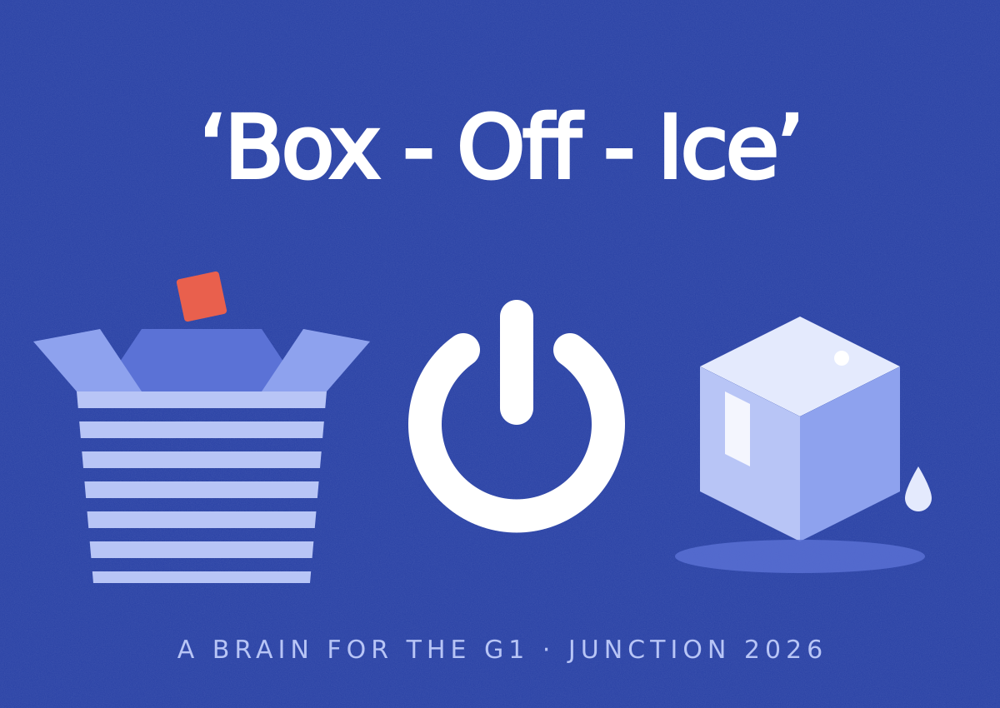

# Box Office (aalto-humanoid): Aaltonomous Humanoid (Junction 2026, challenge 11)

Unitree G1 + Dex3 sorts 3–5 coloured objects into three bins, by a fixed rule or by a free-text instruction.
Our submission is a policy server (Docker image, websocket + msgpack on :8000). Plan and status: [PLAN.md](PLAN.md).



Logo: `brand/box-office-rebus.svg` (the rebus Box · Off · Ice) and `brand/box-office-mark.svg` (the mark).

## Layout

| Path | What |
|---|---|
| `sorter/instruction.py` | Free-text instruction → `{colour / shape / (colour, shape) / "default": bin}` |
| `sorter/perception.py` | Upstream HSV + depth detector + top-face shape classification |
| `sorter/policy.py` | Upstream classical state machine with our mapping, perception and robustness fixes |
| `sorter/nemotron.py` | Optional Nemotron 3.5 Super VL sort planner: head frame + detections + instruction → validated plan |
| `sorter/server.py` | Policy server (what the image runs) |
| `sorter/synth.py` | Synthetic head RGB-D frames with true triangular prisms (tests) |
| `tests/` | Parser, perception and policy/server tests (no GPU) |
| `scripts/fetch_upstream.sh` | Pinned clone of the organisers' repo + G1 URDF into `upstream/` (gitignored) |
| `sim/setup_fixloop.sh` | Bare-metal Isaac install on a Verda VM, fixes upstream pip-constraint conflicts |
| `sim/run_eval.sh`, `sim/par_eval.sh` | Score our image in the sim: one instance, or one instance per GPU in parallel |
| `results/sim-dr-2026-11-14/` | Our image on randomised scenes, 12 trials per task (the 13.11 results are the oracle, not ours) |

## Run

```sh
bash scripts/fetch_upstream.sh
uv venv --python 3.12 .venv && uv pip install --python .venv/bin/python -r requirements.txt pytest
.venv/bin/python -m pytest -q tests/                       # ~1 min
PYTHONPATH=.:upstream .venv/bin/python -m sorter.server    # :8000
PYTHONPATH=upstream .venv/bin/python -m aaltonomous.deploy.replay --synthetic 100 --policy ws://localhost:8000
docker build -t junction-sorter:dev .                       # context = this directory
```

## Nemotron 3.5 Super VL sort planner (optional, online)

With `NVIDIA_API_KEY` set (see `.env.example`), the policy calls NVIDIA Nemotron 3.5 Super VL once per episode, on
the first head frame with objects. It gets the image, our detections (id, colour, shape, position) and the
instruction, and must answer with one `submit_sort_plan` tool call: rules in the scorer's keys plus a bin per object.
`sorter/nemotron.py` validates the plan against the known colours, shapes, bins and detection ids, and checks that
the bin the model gives each object equals what its own rules give (grounding self-check). On an error it sends the
errors back and asks again (2 attempts). A valid plan replaces the parser mapping. A missing key, a timeout
(25 s budget) or an invalid plan keeps the offline parser mapping. The log line starts with `Nemotron 3.5 Super VL:`
and lists where the plan differs from the parser. The finals have no network, so the image runs without a key there.
`SORTER_NEMOTRON=fallback` calls Nemotron only when the parser is unsure; `off` disables it. On NixOS with a uv
Python, add `SSL_CERT_FILE=/etc/ssl/certs/ca-certificates.crt` (otherwise TLS verification fails).

```sh
NVIDIA_API_KEY=... PYTHONPATH=.:upstream .venv/bin/python -m sorter.nemotron --synthetic "Cubes go left, everything else right."
NVIDIA_API_KEY=... PYTHONPATH=.:upstream .venv/bin/python -m sorter.nemotron --eval    # 17 unseen paraphrases, Nemotron vs parser
NVIDIA_API_KEY=... PYTHONPATH=.:upstream .venv/bin/python -m sorter.server             # policy server with Nemotron planning
```

## Simulation (Verda GPU)

Isaac Sim needs an RTX GPU (L40S / RTX PRO 6000; not A100/H100) and driver ≥ 580.65.06.
Do not use the `.CC` (confidential compute) types such as `1RTXPRO6000.30V.CC`: CUDA works after
`nvidia-smi conf-compute -srs 1`, but CC mode has no Vulkan, so the sim cannot render (seen 2026-11-14).

```sh
cd ../starter
pnpm j gpu up 1L40S.20V --hours 3 --disk 200
pnpm j gpu push <vm> ../aalto-humanoid/upstream && pnpm j gpu push <vm> ../aalto-humanoid/sim
pnpm j gpu ssh <vm> 'apt-get install -y libturbojpeg libglu1-mesa libxt6 libvulkan1 libegl1 libgl1 libxrandr2 libxi6 libsm6 libice6 libxkbcommon0 cmake build-essential unzip'
pnpm j gpu ssh <vm> 'nohup bash /root/work/sim/setup_fixloop.sh /root/work/upstream > /root/fixloop.log 2>&1 &'   # ~30-40 min
pnpm j gpu ssh <vm> 'cd /root/work/upstream && bash aaltonomous/cloud/aalto.sh sim && bash aaltonomous/cloud/aalto.sh check'
# our server on the VM (image or source), then:
pnpm j gpu ssh <vm> 'cd /root/work/upstream && bash aaltonomous/cloud/aalto.sh eval --policy ws://localhost:8000 --team junction --task sort_language --trials 5'
pnpm j gpu down <vm>
```
